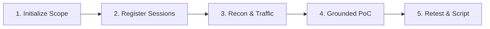

# SecArbiter Playbook: Autonomous Security Verification & Agentic Pentesting

This skill guides AI coding agents (Antigravity, Claude, Codex, Windsurf, Cursor) in orchestrating high-assurance security audits using **SecArbiter**.

SecArbiter operates under a strict **Zero-LLM-on-Server** principle: the host model orchestrates planning and hypothesis generation, while SecArbiter acts as an independent forensic execution and verification engine.

---

## 1. Five-Phase Penetration Testing Sequence

Follow this sequence to ensure zero-hallucination, reproducible vulnerability findings:



### Phase 1: Initialize Scope & Boundaries
Before dispatching any network probe, define engagement boundaries using `engagement_create`:
```json
{
  "name": "Target API Audit",
  "allowed_hosts": ["api.target.com", "*.target.com"],
  "allowed_subnets": ["93.184.216.0/24"],
  "denied_paths": ["/logout", "/delete-account", "/admin/reset-db"],
  "allow_private_ips": false
}
```
* **Safety Rule**: Keep `allow_private_ips: false` for external audits. Set to `true` **only** when auditing dedicated local staging containers (`127.0.0.1` or internal Docker networks).
* Save the returned `engagement_id` for all downstream operations.

### Phase 2: Register Multi-Context Sessions
To prove authorization flaws (IDOR, BOLA, privilege escalation), register at least two distinct user contexts:
```json
{
  "engagement_id": "<ENGAGEMENT_ID>",
  "label": "Tenant-Alice",
  "role": "customer",
  "headers": { "Authorization": "Bearer alice_token_jwt" }
}
```
* Raw tokens are stored securely in SQLite and automatically masked from tool outputs.
* Reference accounts exclusively by their `session_ref_id`.

### Phase 3: Reconnaissance & Forensic Traffic
1. **Tech Stack & Manifest Scanning**:
   ```json
   {
     "engagement_id": "<ENGAGEMENT_ID>",
     "url": "https://api.target.com/api/techstack",
     "manifest_content": "werkzeug==0.14.1\nlog4j-core==2.14.1\n"
   }
   ```
2. **Dispatched HTTP Traffic**:
   ```json
   {
     "engagement_id": "<ENGAGEMENT_ID>",
     "session_ref_id": "<ALICE_SESSION_ID>",
     "method": "GET",
     "url": "https://api.target.com/api/documents/102"
   }
   ```
   * SecArbiter enforces **True DNS Pinning** via socket resolution to prevent TOCTOU DNS rebinding.
   * Every request captures an immutable raw HTTP record (`artifact_id`) with SHA-256 integrity hash.

### Phase 4: Draft & Grounded PoC Validation
1. **Draft Finding** (starts in `suspected` status):
   ```json
   {
     "engagement_id": "<ENGAGEMENT_ID>",
     "title": "BOLA: Tenant Alice accessing Tenant Bob Document",
     "vuln_class": "idor",
     "endpoint": "/api/documents/102",
     "severity": "HIGH",
     "hypothesis": "Alice can retrieve Bob's invoice without 403 Forbidden"
   }
   ```
2. **Validate PoC Against Raw Wire Artifacts**:
   ```json
   {
     "finding_id": "<FINDING_ID>",
     "exploit_artifact_id": "<RAW_ARTIFACT_ID>",
     "assertion_json": "{\"endpoint\":\"/api/documents/102\",\"actor_session_label\":\"Tenant-Alice\",\"target_resource_id\":\"102\",\"observed_unauthorized_status\":200,\"expected_blocked_status\":403,\"target_data_marker\":\"bob_invoice\"}"
   }
   ```
   * **Anti-Hallucination Gate**: The engine reads the raw HTTP wire bytes on disk. If the assertion contradicts the wire capture (e.g. claiming HTTP 200 when response was 401), the validation is rejected as `INCONCLUSIVE`.
   * **Boundary Rule**: Vulnerabilities requiring out-of-band listener telemetry (SSRF) or DOM sink execution (XSS) are capped at `INCONCLUSIVE (Host-attested)` unless auxiliary evidence is supplied.

### Phase 5: Autonomous Remediation & Retest
1. **Generate Deterministic Reproduction Script**:
   ```json
   {
     "finding_id": "<FINDING_ID>",
     "script_type": "curl"
   }
   ```
   * Generated scripts adhere to standard exit codes:
     * `0`: Vulnerability confirmed / reproduced.
     * `1`: Remediated / access denied (401/403/404).
     * `2`: Network unreachable / connection error.
2. **Live Retest**:
   ```json
   {
     "finding_id": "<FINDING_ID>"
   }
   ```
   * `finding_retest` re-executes the saved request against the live endpoint. If patched, the status automatically transitions to `FIXED`.

---

## 2. Assertion Schema Blueprints

### A. IDOR / BOLA Assertion
```json
{
  "endpoint": "/api/invoices/99",
  "actor_session_label": "Tenant-Alice",
  "target_resource_id": "99",
  "observed_unauthorized_status": 200,
  "expected_blocked_status": 403,
  "target_data_marker": "Secret Account Data"
}
```

### B. SQL Injection (Boolean Differential)
Requires both `exploit_artifact_id` (True condition) and `control_artifact_id` (False condition):
```json
{
  "endpoint": "/api/search",
  "sqli_type": {
    "BooleanDifferential": {
      "baseline_body_len": 180,
      "true_condition_body_len": 450,
      "false_condition_body_len": 180,
      "repetitions_consistent": 2
    }
  }
}
```

### C. OS Command Injection / RCE
```json
{
  "endpoint": "/api/ping",
  "rce_type": {
    "OutputMarker": {
      "marker_value": "uid=0(root) gid=0(root)"
    }
  }
}
```

### D. CORS Misconfiguration
```json
{
  "endpoint": "/api/userinfo",
  "untrusted_origin": "https://evil-attacker.com",
  "observed_allow_origin": "https://evil-attacker.com",
  "observed_allow_credentials": true
}
```

### E. Universal Composable Predicates (Novel Classes)
For any vulnerability class not covered by dedicated schemas:
```json
{
  "endpoint": "/api/custom",
  "predicates": [
    { "StatusCodeEquals": 200 },
    { "HeaderEquals": { "key": "X-Custom-Auth", "value": "bypassed" } },
    { "BodyContains": "ADMIN_DASHBOARD" }
  ]
}
```

---

## 3. CLI Equivalent Commands

For standalone debugging or CI/CD pipelines without MCP stdio:

```bash
# Scan manifests or target banners
secarbiter scan https://api.target.com/ --manifest requirements.txt

# Manage engagements
secarbiter engagements list

# Verify finding assertion
secarbiter verify -f <FINDING_UUID> -a assertion.json

# Generate reproduction script
secarbiter poc -f <FINDING_UUID> -t curl -o reproduce.sh

# Export audit report
secarbiter report -e <ENGAGEMENT_UUID> -f markdown -o audit_report.md
```
